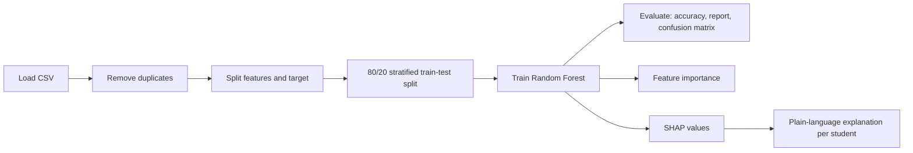
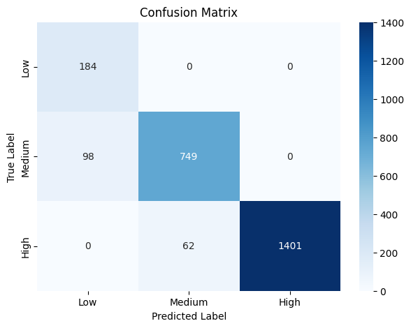
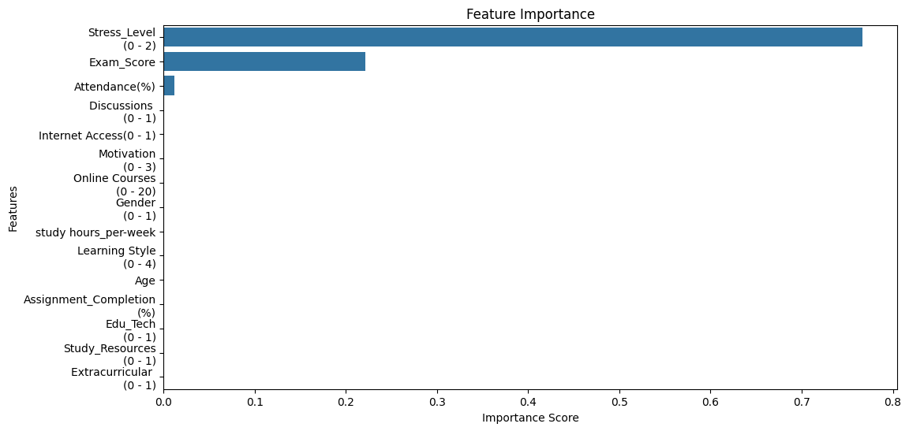
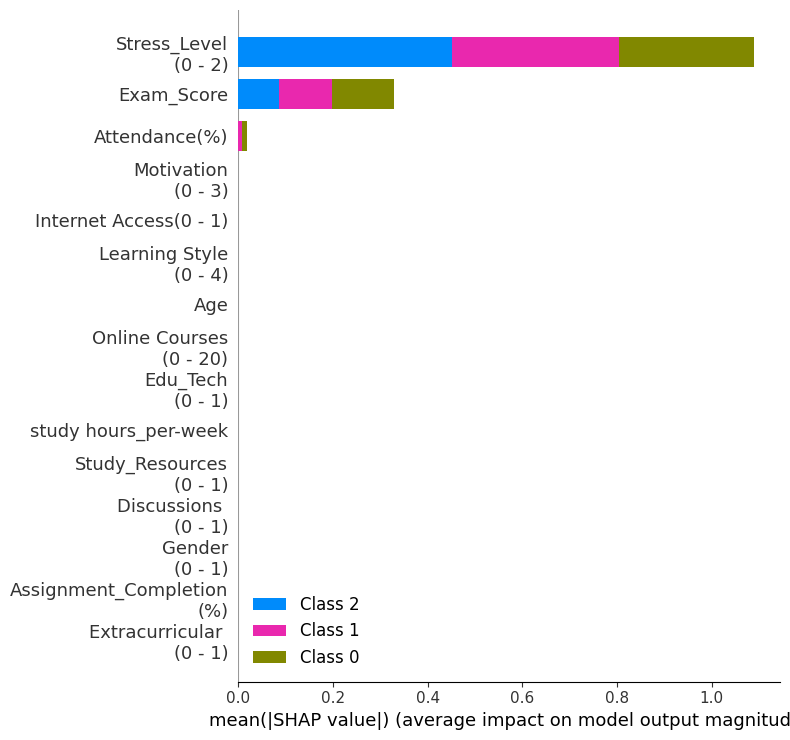

# Adaptive Explainable AI-Based Student Learning Difficulty Detection


A machine learning project that **predicts how much difficulty a student is likely to face in learning (Low, Medium or High)** and **explains every prediction in plain language**, so that teachers can see not only *what* the model predicts but also *why*.

The project has two parts:

1. **A Jupyter / Google Colab notebook** that cleans the data, trains and evaluates a Random Forest model, and explains the results with feature importance and SHAP.
2. **A Streamlit web app** where you enter a student's details, get the predicted difficulty level, and read an explanation of the prediction.

---

## Table of contents

- [Problem statement and motivation](#problem-statement-and-motivation)
- [Objectives](#objectives)
- [Key features](#key-features)
- [Dataset](#dataset)
- [Methodology](#methodology)
- [Results](#results)
- [Explainability](#explainability)
- [Streamlit app](#streamlit-app)
- [Repository structure](#repository-structure)
- [Getting started](#getting-started)
- [Limitations](#limitations)
- [Future work](#future-work)
- [Tech stack](#tech-stack)
- [References](#references)
- [Author](#author)

---

## Problem statement and motivation

Existing systems often struggle to identify students who are facing learning difficulties, and they do not always give clear explanations of their predictions. A prediction such as "this student is at risk" is hard to act on if nobody can tell what led to it.

The motivation for this project is to build a system that can identify student learning difficulties **and** clearly explain the prediction results, for better understanding and support.

## Objectives

- Use machine learning to detect a student's learning difficulty level (Low, Medium or High).
- Identify struggling students at an early stage.
- Provide clear explanations of each prediction using Explainable AI (XAI).
- Present the results through a simple app that a non-technical user can operate.

## Key features

- **Data cleaning:** removal of duplicate records before training.
- **Random Forest classifier** with a reproducible, stratified train/test split.
- **Evaluation** with accuracy, a classification report and a confusion matrix.
- **Feature importance** to show which columns the model relies on overall.
- **SHAP explanations** to show which columns pushed an individual student's prediction towards or away from a difficulty level.
- **Plain-language explanations** generated for each student.
- **Interactive Streamlit app** for entering student details and reading the result.

## Dataset

The dataset is stored in [`data/final_trained.csv`](data/final_trained.csv).

| Item | Value |
|---|---|
| Rows in the file | 14,003 |
| Exact duplicate rows | 1,534 |
| Rows after removing duplicates | 12,469 |
| Input columns (features) | 15 |
| Target column | `Difficulty Level(0 - 2)` |

**Target classes** (after removing duplicates):

| Value | Meaning | Rows |
|---|---|---|
| 0 | Low difficulty | 922 |
| 1 | Medium difficulty | 4,233 |
| 2 | High difficulty | 7,314 |

The classes are imbalanced: Low difficulty is the smallest group, which is why the model uses balanced class weights (see [Methodology](#methodology)).

**Input columns** (observed value ranges in the data):

| Column | Observed range |
|---|---|
| `study hours_per-week` | 5 – 44 |
| `Attendance(%)` | 60 – 100 |
| `Study_Resources (0 - 1)` | 0 – 2 |
| `Extracurricular (0 - 1)` | 0 – 1 |
| `Motivation (0 - 3)` | 0 – 2 |
| `Internet Access(0 - 1)` | 0 – 1 |
| `Gender (0 - 1)` | 0 – 1 |
| `Age` | 18 – 29 |
| `Learning Style (0 - 4)` | 0 – 3 |
| `Online Courses (0 - 20)` | 0 – 20 |
| `Discussions (0 - 1)` | 0 – 1 |
| `Assignment_Completion (%)` | 50 – 100 |
| `Exam_Score` | 40 – 100 |
| `Edu_Tech (0 - 1)` | 0 – 1 |
| `Stress_Level (0 - 2)` | 0 – 2 |

The ranges written in some column names come from the source file; the table above shows the values that actually occur.

## Methodology



1. **Load the data** and strip whitespace from the column names.
2. **Remove duplicate rows** (14,003 rows become 12,469).
3. **Separate** the 15 input columns (`X`) from the target column (`y`).
4. **Split** the data 80% / 20% into 9,975 training rows and 2,494 test rows. The split is **stratified** on the target so that every class appears in the same proportion in both sets, and uses `random_state=42` so that results can be reproduced.
5. **Train** a Random Forest classifier:

   | Parameter | Value |
   |---|---|
   | `n_estimators` | 50 |
   | `max_depth` | 3 |
   | `min_samples_split` | 10 |
   | `min_samples_leaf` | 50 |
   | `max_features` | `None` (all features are considered at each split) |
   | `class_weight` | `'balanced'` |
   | `random_state` | 42 |

   `class_weight='balanced'` gives more weight to the smaller classes so that the Low difficulty group is not ignored. Using `max_features=None` makes the result **stable across scikit-learn versions**.
6. **Evaluate** on the held-out test set.
7. **Explain** the model with feature importance and SHAP.

## Results

**Accuracy on the test set: 93.58%** (2,494 students)

| Class | Precision | Recall | F1-score | Support |
|---|---|---|---|---|
| 0 – Low | 0.65 | 1.00 | 0.79 | 184 |
| 1 – Medium | 0.92 | 0.88 | 0.90 | 847 |
| 2 – High | 1.00 | 0.96 | 0.98 | 1,463 |
| **Macro average** | 0.86 | 0.95 | 0.89 | 2,494 |
| **Weighted average** | 0.95 | 0.94 | 0.94 | 2,494 |

### Confusion matrix

<p align="center">
  
</p>

|  | Predicted Low | Predicted Medium | Predicted High |
|---|---|---|---|
| **Actual Low** | 184 | 0 | 0 |
| **Actual Medium** | 98 | 749 | 0 |
| **Actual High** | 0 | 62 | 1,401 |

How to read it:

- All 184 Low-difficulty students are found.
- 98 Medium students are predicted as Low, which is why Low has a precision of 0.65.
- 62 High students are predicted as Medium.
- The model never confuses Low with High.

## Explainability

### Feature importance

<p align="center">
  
</p>

The model relies almost entirely on three columns:

| Feature | Importance |
|---|---|
| `Stress_Level` | 0.767 |
| `Exam_Score` | 0.222 |
| `Attendance(%)` | 0.012 |
| All other columns | ≈ 0 |

### SHAP summary

<p align="center">
  
</p>

SHAP assigns each feature a value showing how strongly it pushed a prediction towards or away from a class. The plot above averages these values over the test set (Class 0 = Low, Class 1 = Medium, Class 2 = High).

### Explanation for a single student

For every student, the notebook and the app turn the SHAP values into short sentences. For example, for a student predicted as **High**:

> The model predicted **High** difficulty mainly because of **Stress_Level, Exam_Score**.
> - **Stress_Level = 2** (higher than the dataset average) pushed the prediction **towards** High difficulty.
> - **Exam_Score = 40** (lower than the dataset average) pushed the prediction **towards** High difficulty.

## Streamlit app

The app trains the model with the same settings as the notebook, so the numbers match: **93.58%** accuracy and the same confusion matrix.

| Tab | What it shows |
|---|---|
| **Predict a student** | A form built from the dataset columns. After clicking *Predict*, it shows the predicted level, the confidence for each level, a plain-language explanation and a SHAP bar chart. |
| **Model performance** | Accuracy, the confusion matrix and the overall feature importance. |
| **Dataset** | A preview of the data used. |

The sidebar lets you choose a different CSV file or upload your own.

## Repository structure

```
student-learning-difficulty-detection/
├── app.py                  # Streamlit web app
├── requirements.txt        # Python dependencies
├── data/
│   └── final_trained.csv   # Dataset
├── notebooks/
│   └── final_code_of_my_intern_project.ipynb   # Training, evaluation and SHAP explanations
├── docs/
│   └── final_intern_project.pptx               # Project presentation
├── assets/                 # Images used in this README
│   ├── confusion_matrix.png
│   ├── feature_importance.png
│   └── shap_summary.png
├── .gitignore
└── README.md
```

## Getting started

### Option 1: Run the notebook in Google Colab

1. Open [Google Colab](https://colab.research.google.com/), choose **File → Upload notebook**, and select `notebooks/final_code_of_my_intern_project.ipynb`.
2. Click **Runtime → Run all**.
3. When the upload cell appears, upload `data/final_trained.csv`.

The notebook should print `Accuracy : 93.58 %`.

### Option 2: Run the Streamlit app locally

You need Python 3.9 or later.

```bash
# 1. Clone the repository
git clone https://github.com/<your-username>/student-learning-difficulty-detection.git
cd student-learning-difficulty-detection

# 2. (Optional) create a virtual environment
python -m venv venv
venv\Scripts\activate          # Windows
# source venv/bin/activate     # macOS / Linux

# 3. Install the dependencies
pip install -r requirements.txt

# 4. Start the app
python -m streamlit run app.py
```

Streamlit prints a **Local URL** (usually `http://localhost:8501`). Open it in your browser. The first load takes a few seconds while the model trains.

### Using the app

1. Open the **Predict a student** tab.
2. Enter the student's details in the form.
3. Click **Predict learning difficulty**.
4. Read the predicted level, the confidence chart and the explanation.

## Limitations

- **Low-difficulty precision is 0.65.** About one in three students predicted as Low is actually Medium.
- **High students can be missed.** 62 of 1,463 High-difficulty students (about 4%) are predicted as Medium.
- **The model depends on very few columns.** In this dataset the difficulty level is driven almost entirely by `Stress_Level`, `Exam_Score` and `Attendance(%)`; the other twelve columns have almost no influence. The model's behaviour therefore reflects how the target column in this dataset was defined. A forest without a depth limit fits the data almost perfectly for the same reason, so the 93.58% here comes from deliberately shallow, stable settings and is not an upper limit.
- **Results apply to this dataset.** The model has not been validated on other student populations, so it should be used as a decision-support tool and not as a replacement for a teacher's judgement.
- The explanations show which features influenced a prediction. They describe the model's behaviour and do not prove cause and effect.

## Future work

- Dynamic risk analysis of students over time.
- A weekly performance index that compares each week with past results and explains the main reasons for improvement or decline.
- Personalised recommendations for weekly improvement, especially for students who are moving towards the risk zone.
- Validation on more diverse data and a fairer balance between the difficulty classes.

## Tech stack

- **Language:** Python
- **Data:** pandas, NumPy
- **Machine learning:** scikit-learn (Random Forest)
- **Explainability:** SHAP
- **Visualisation:** Matplotlib, Seaborn
- **App:** Streamlit
- **Environment:** Google Colab / Jupyter

## References

1. Alhazmi, E., & Sheneamer, A. (2023). Early predicting of students performance in higher education. *IEEE Access, 11*, 27579–27589. https://doi.org/10.1109/ACCESS.2023.3250702
2. Khosravi, H., Shum, S. B., Chen, G., Conati, C., Tsai, Y.-S., Kay, J., Knight, S., Martinez-Maldonado, R., Sadiq, S., & Gašević, D. (2022). Explainable Artificial Intelligence in education. *Computers and Education: Artificial Intelligence, 3*, 100074. https://doi.org/10.1016/j.caeai.2022.100074
3. Ahmed, E. (2024). Student performance prediction using machine learning algorithms. *Applied Computational Intelligence and Soft Computing, 2024*, Article ID 4067721. https://doi.org/10.1155/2024/4067721

## Author

**Tompa Eswara Rao**

Developed as an internship project. The full project presentation is in [`docs/final_intern_project.pptx`](docs/final_intern_project.pptx).
